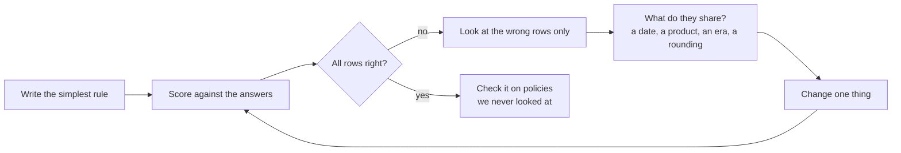
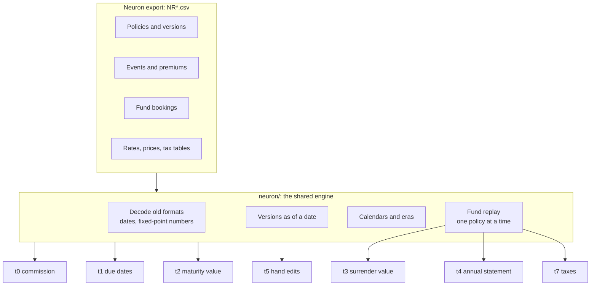
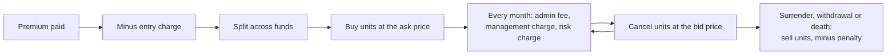
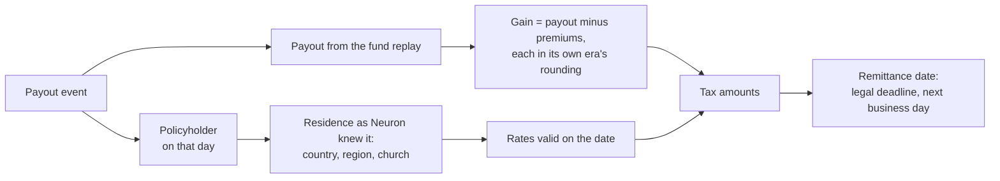
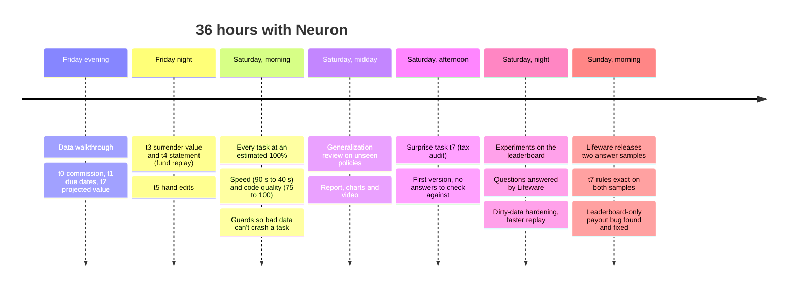

# Neuron migration: 30 years of insurance rules, exact to the cent

Our entry for the Lifeware challenge at the Neural Wave Hackathon 2026.

NeuralWave Life is switching off **Neuron**, an insurance system that ran on COBOL until 2007 and on Java after that.
Nobody documented its formulas. We had its data export and, for most tasks, a set of answers it produced. Our job was
to find the hidden rules and write them again as plain Python that gives the same answers, **to the cent and to
the day**, also for policies we never saw.


## Results at a glance

| Task | What it computes | Public leaderboard (unseen policies) |
|---|---|---|
| t0 Commission | broker commission per premium | **100%** (80,592 / 80,592) |
| t1 Next due dates | the next premium dates and when the money is collected | **100%** (5,005 / 5,005) |
| t2 Projected maturity value | the value a policy was projected to reach | **100%** (986 / 986) |
| t3 Surrender value | what a customer gets when cancelling, on any date | **100%** (3,028 / 3,028) |
| t4 Annual statement | yearly premiums and charges per policy | **100%** (11,648 / 11,648) |
| t5 Hand edits | rows that no rule explains: manual corrections | 54 flagged on train |
| t7 Tax audit (surprise task) | taxes withheld per payout, and per policy and year | see [t7](#t7-the-surprise-tax-audit) |

The leaderboard scores public policies whose answers we never had. Getting every row right there is our best
evidence that the rules are general and not tuned to the training data.

On the training answers we miss 54 rows, and they are exactly the 54 rows t5 flags. 38 of them are on Neuron's own
list of manual corrections (`NREXCP`). The other 16 move by whole euros, so we believe they are hand edits nobody
listed.

| Also measured | |
|---|---|
| Runtime, all tasks t0–t7 together | 49 s, 1.6 GB memory (Python 3.10, laptop) |
| Package size | 85 files, standard library only, Python 3.10 or newer |
| Dirty data (blank, `NULL`, `None`, garbage values, short rows, empty files) | 28 scenarios, 0 crashes: a bad row costs only its own policy |
| Unseen public policies that ended by surrender or death | 286 / 286 end at exactly 0 fund units in our replay |

## How we worked

Every rule came out of the same loop: write the simplest version, score it, look only at the rows that are wrong,
find what they have in common, change one thing, score again.



A rule is never just a formula. Most of the work was in the small choices around it:

| Choice | Example of what it decided |
|---|---|
| Which date | the broker who was valid on the day the **money arrived**, not on the due date |
| Which version of a row | the policy version valid on that day, as Neuron knew it then |
| Which rounding | COBOL **cut** cents off until the 11 August 2007 conversion; Java rounds half up |
| Which calendar | collections move to the next **Ticino** business day (cantonal holidays, no Good Friday) |
| Which exceptions | hand edits are listed for t5, never patched into a rule |


## How the code is built

The submission is a small engine shared by all tasks, plus one short module per task. It only reads the legacy
export, never the answers (only t5 compares with the answers, because finding hand edits is its job).



The heart is the **fund replay**. Neuron left most booking amounts blank in the export, so we rebuild them: every
premium buys fund units, every month the charges cancel units, and customer orders sell units. t3, t4 and t7 all
read this one replay, which runs once and is shared.



## t7: the surprise tax audit

On Saturday afternoon a new task arrived: for every payout since 1994, recompute the tax Neuron withheld and the day
it paid it to the tax office, for Swiss, Italian, German and Luxembourg residents. This time there were **no answer
files** at all, only two example rows in the task description.

What the data does tell you is **which** taxes Neuron booked (table `NRTAXB`), with the amounts left blank. So we
could prove every rule about *whether* a tax applies (0 mismatches against Neuron's bookings), but amounts and dates
were educated guesses until Lifeware released the answers of the first two leaderboard samples on Sunday morning.



The rules we ended with, each confirmed on both released samples:

1. Residence, holder and rates count **as Neuron knew them** when it booked; corrections entered later don't.
2. The taxable payout is what was paid: units sold minus the surrender penalty; a death claim pays the death benefit.
3. The gain is the payout minus the premiums paid, each premium converted on its own day and rounded in its own era.
4. **Switzerland:** 8% withholding on the payout above 5,000 CHF, only if the holder refused to be reported; 2.5% stamp duty on single premiums.
5. **Germany:** 25% on the gain, lowered when church tax applies; solidarity surcharge and church tax on top, cut to the cent.
6. **Italy:** each part of the gain is taxed at the rate of the period it built up in (12.5%, 20%, 26%); a yearly stamp duty on the policy value, restated once in 2019.
7. Taxes reach the office on the legal deadline (Germany the 10th, Italy the 16th, Switzerland 30 days after month end), moved to the next business day of that country.
8. A payout with no tax still shows the base Neuron calculated: the payout in Switzerland, 0.00 elsewhere.

**How t7 developed:**

| Version | What changed | Released samples (payout, annual) |
|---|---|---|
| First version | rules from the data and tax law, amounts unverified | 2/20 and 15/20 on sample 1 |
| After Lifeware's answers | base for untaxed payouts, no date for stamp-duty-only payouts, death payouts | 10/20 and 15/20 on sample 1 |
| After the released answers | business-day deadlines, Italian rate periods, rounding per era | **20/20 + 20/20, 40/40 + 30/30** |

**The hardest bug was not a tax rule.** For hours our payout score on the leaderboard stayed near zero while the same
code scored well on our laptop. The cause: payout amounts were read from a column of the bookings file whose values
on the evaluation machine did not match ours. We reproduced the exact leaderboard score locally by putting wrong
values into that column, then changed the code to compute every payout from the units sold and the fund prices,
the same path that already gave t3 100% on the leaderboard. With that column filled with garbage, t3, t4 and t7 now
give identical results.

## What did not work

We kept a log of failed ideas, because they taught us as much as the rules that worked.

- **Guessing tax amounts from the law.** Our first t7 dates followed tax law without weekend shifts, and the untaxed
  base followed a guess. Both were wrong. Data and Lifeware's answers fixed them; the law alone could not.
- **Trusting a laptop score.** A result that only holds on one machine is not a result. Since then every build is
  tested on deliberately broken copies of the input: quoted fields, blank amounts, wrong amounts, missing rows.
- **One global switch date for the old system.** We first thought each policy switched from COBOL to Java on its own
  conversion event. The data showed one system-wide date: policies that ended before it never got the event, but
  were still COBOL.
- **Gaming the code-quality score.** The maintainability score (radon) gives 100 to code that hides its arithmetic
  behind function calls. We did not do that. Our engine reached 100 by splitting rules into small, honest modules;
  the t7 files are denser and bring the package to about 84.

## Timeline



## How to run

The challenge data is not in this repository. Unpack it so that `LifewareChallenge/participants/legacy/` holds the
`NR*.csv` export and `LifewareChallenge/participants/targets/` holds the answers.

```bash
pip install -r my_solution/requirements.txt
```

The file is empty on purpose: the submission uses only the Python standard library (3.10 or newer). Then score it:

```bash
cd LifewareChallenge/participants/starter_kit && python check.py --submission my_solution
```

## Folder structure

| Path | What it is |
|---|---|
| `my_solution/` (copy it into the starter kit to run check.py) | **The submission.** `submission.py` only re-exports the task functions |
| `  …/my_solution/neuron/` | the shared engine: old formats, versions, calendars, eras, fund replay, charges, taxes |
| `  …/my_solution/tasks/` | one module per task |
| `tests/` | the readiness checks: scores, runtime, memory, other dates, exports with missing rows |
| `report/main.pdf` | the 3-page report |

## Team

Amar Omerovic, Uzair Naeem, Aanchal Aanchal, Davide Frosi, Fatih Tkin.

We built this utilizing agentic AI. Several AI agents worked in parallel on separate tasks, and one coordinating agent
checked every result by rerunning it before anything was accepted. We directed the work, made the decisions and
reviewed every change.
