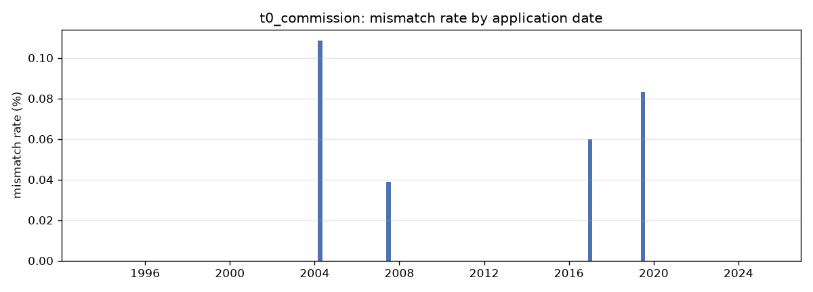
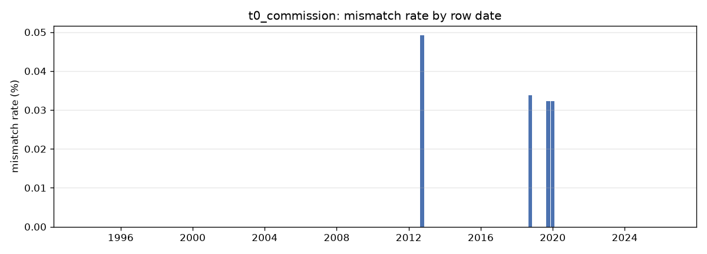
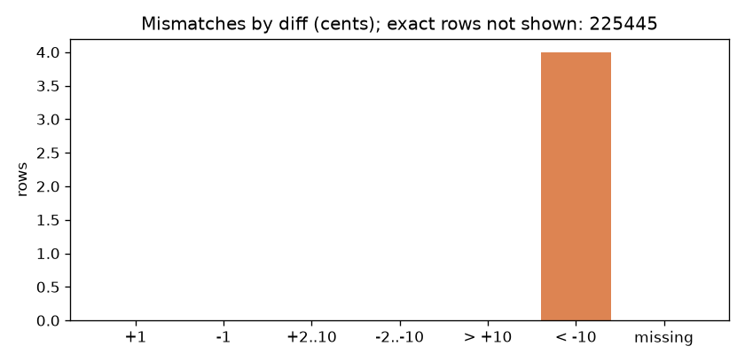

# Harness report: t0_commission (predictions harness/reports/t0/predictions.csv)

Accuracy **225445/225449 = 99.9982%** (exact rows, scoring.py semantics)

```
t0_commission: 225445/225449 exact = 99.9982%; 4 mismatches, 0 missing predictions, 80598 extra keys; 409 NREXCP manual corrections not scored

## Diff histogram (predicted - target, cents)
         0:  225445
        +1:       0
        -1:       0
    +2..10:       0
   -2..-10:       0
     > +10:       0
     < -10:       4
   missing:       0

## Where the mismatches concentrate (value sets covering most of them)
  tariff_key in {FKM02LB, FSU04EA, FKW02LB} covers 3/4 mismatches (75.0%) within 10.3% of the rows  x7.3
  uw_class in {E2} covers 3/4 mismatches (75.0%) within 23.2% of the rows  x3.2
  tariff_gen in {02, 04, 03} covers 4/4 mismatches (100.0%) within 69.3% of the rows  x1.4
  broker_tier in {B} covers 3/4 mismatches (75.0%) within 45.4% of the rows  x1.7
  smoker in {N} covers 4/4 mismatches (100.0%) within 79.1% of the rows  x1.3
  sex_basis in {U} covers 2/4 mismatches (50.0%) within 30.1% of the rows  x1.7
  era in {java} covers 3/4 mismatches (75.0%) within 56.4% of the rows  x1.3
  product in {FLKL, FLSP} covers 3/4 mismatches (75.0%) within 61.6% of the rows  x1.2

## Groups with a high mismatch rate (lift vs overall)
  uw_class = E2          3/52416    0.0%  lift 3x

## Decision tree (depth 3) mismatch vs match, leaves as rules
  [   2/325      0.6%] premium > 6000 AND age_at_start > 44.5 AND currency == CHF
  [   2/6936     0.0%] premium <= 6000 AND premium <= 192.5 AND premium > 167.5
  [   0/29058    0.0%] premium <= 6000 AND premium <= 192.5 AND premium <= 167.5
  [   0/3611     0.0%] premium <= 6000 AND premium > 192.5 AND age_at_start <= 18.5
  [   0/184519   0.0%] premium <= 6000 AND premium > 192.5 AND age_at_start > 18.5
  [   0/777      0.0%] premium > 6000 AND age_at_start <= 44.5
  [   0/223      0.0%] premium > 6000 AND age_at_start > 44.5 AND currency != CHF

## Change points of the mismatch rate
  over app_date (225449 rows):
    Pelt: no change point (rate is stable over time)
    best split at 2017-03-17: 0.0% before -> 0.0% after (z=2.0, not significant)
  over row_date (225449 rows):
    Pelt: no change point (rate is stable over time)
    best split at 2020-03-01: 0.0% before -> 0.0% after (z=1.6, not significant)

## Era boundary check (row_date within 90 days of 2007-08-11)
  window: 0/2324 mismatches = 0.0% vs overall 0.0%  (nothing left at the switch)

## Top 10 mismatching rows by |diff|
 policy_id  due_nr pred_amount tgt_amount  diff   app_date tariff_key mort_table  age_at_start frequency broker_tier   era nrexcp
BL10001328       1      859.00     936.00 -7700 2019-09-09    FSU04EA       M12U            45         E           B  java       
BL10001299     103        5.70      79.70 -7400 2004-05-24    FKM02LB       M94U            39         M           B cobol       
BL10002438      11      242.40     310.40 -6800 2007-08-11    FKW02LB       M94U            63         J           A  java       
BL10004554      35        5.10      16.10 -1100 2017-03-17    FXU03LC       M12U            36         M           B  java       
```







Full list of mismatching rows with features: `mismatches.csv`.