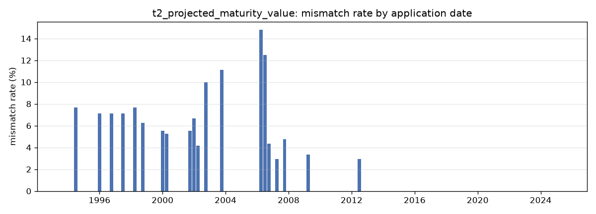
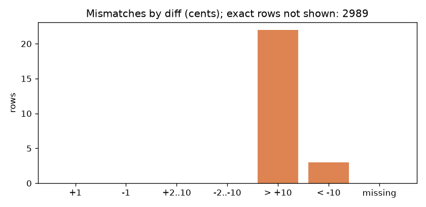

# Harness report: t2_projected_maturity_value (predictions /Users/amaromerovic/Projects/Hackathon/Rad/lifeware/repo/harness/reports/t2/predictions.csv)

Accuracy **2989/3014 = 99.1705%** (exact rows, scoring.py semantics)

```
t2_projected_maturity_value: 2989/3014 exact = 99.1705%; 25 mismatches, 0 missing predictions, 0 extra keys; 5 NREXCP manual corrections not scored

## Diff histogram (predicted - target, cents)
         0:    2989
        +1:       0
        -1:       0
    +2..10:       0
   -2..-10:       0
     > +10:      22
     < -10:       3
   missing:       0

## Where the mismatches concentrate (value sets covering most of them)
  era in {cobol} covers 22/25 mismatches (88.0%) within 27.5% of the rows  x3.2
  sex_basis in {M, W} covers 25/25 mismatches (100.0%) within 49.1% of the rows  x2.0
  tariff_gen in {01, 02} covers 25/25 mismatches (100.0%) within 49.3% of the rows  x2.0
  mort_table in {M94U} covers 25/25 mismatches (100.0%) within 49.3% of the rows  x2.0
  currency in {CHF} covers 20/25 mismatches (80.0%) within 62.7% of the rows  x1.3
  country in {CH} covers 21/25 mismatches (84.0%) within 69.8% of the rows  x1.2
  sex in {1} covers 16/25 mismatches (64.0%) within 50.7% of the rows  x1.3
  uw_class in {N1, E1, N2} covers 22/25 mismatches (88.0%) within 76.0% of the rows  x1.2

## Groups with a high mismatch rate (lift vs overall)
  app_year = 2006        7/79       8.9%  lift 11x
  tariff_key = FXW01LB     2/37       5.4%  lift 7x
  tariff_key = FSW01EA     3/58       5.2%  lift 6x
  app_year = 2002        4/79       5.1%  lift 6x
  tariff_key = FKM01LA     3/73       4.1%  lift 5x
  app_year = 1998        2/52       3.8%  lift 5x
  app_year = 1996        2/53       3.8%  lift 5x
  tariff_key = FKM02LA     5/140      3.6%  lift 4x
  app_year = 2000        2/58       3.4%  lift 4x
  state = 70          2/61       3.3%  lift 4x
  tariff_key = FXM02LC     2/64       3.1%  lift 4x
  tariff_key = FKW01LA     2/65       3.1%  lift 4x

## Decision tree (depth 3) mismatch vs match, leaves as rules
  [  23/855      2.7%] sex_basis != U AND age_at_start > 34.5 AND premium > 230
  [   2/116      1.7%] sex_basis != U AND age_at_start <= 34.5 AND broker_tier == C
  [   0/384      0.0%] sex_basis != U AND age_at_start <= 34.5 AND broker_tier != C
  [   0/126      0.0%] sex_basis != U AND age_at_start > 34.5 AND premium <= 230
  [   0/1533     0.0%] sex_basis == U

## Change points of the mismatch rate
  over app_date (3014 rows):
    Pelt: 1993-11-07 .. 2006-03-21  n=684    rate 2.0%
    Pelt: 2006-04-01 .. 2006-09-21  n=43     rate 14.0%
    Pelt: 2006-10-04 .. 2025-05-25  n=2287   rate 0.2%
    best split at 2007-04-22: 2.8% before -> 0.1% after (z=7.0, significant)

## Era boundary check (app_date within 90 days of 2007-08-11)
  window: 0/48 mismatches = 0.0% vs overall 0.8%  (nothing left at the switch)

## Top 10 mismatching rows by |diff|
 policy_id pred_maturity_value tgt_maturity_value    diff   app_date tariff_key mort_table  age_at_start frequency broker_tier   era nrexcp
BL10004278           305955.99          309249.99 -329400 2006-12-27    FKM02LA       M94U            48         M           A cobol       
BL10002196           268602.08          270328.08 -172600 2012-08-12    FKM02LA       M94U            40         H           A  java       
BL10002973           122433.68          123931.68 -149800 2007-12-26    FKW02LB       M94U            20         Q           C  java       
BL10003214           191554.14          190398.68  115546 2002-01-28    FXM01LC       M94U            58         M           B cobol       
BL10004378           186388.33          185849.24   53909 2006-09-21    FXM02LC       M94U            58         M           A cobol       
BL10003793           575091.19          574817.71   27348 1994-07-26    FKM01LA       M94U            46         Q           A cobol       
BL10000732           310823.22          310568.48   25474 2006-04-01    FKM02LA       M94U            62         Q           A cobol       
BL10002133           345896.29          345747.74   14855 2000-04-23    FSW01EA       M94U            45         E           B cobol       
BL10000370           326953.73          326819.57   13416 2002-10-20    FKM01LA       M94U            45         Q           B cobol       
BL10001441           143572.15          143469.83   10232 2006-05-09    FKM02LA       M94U            60         J           B cobol       
```





Full list of mismatching rows with features: `mismatches.csv`.