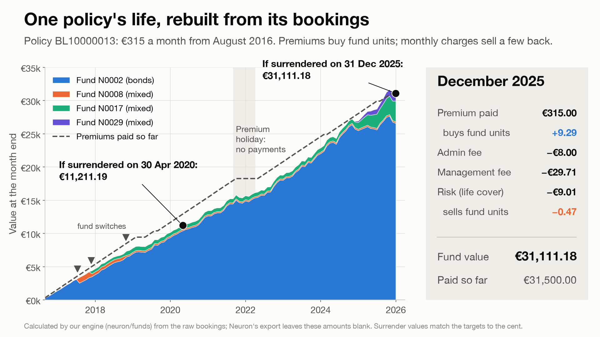
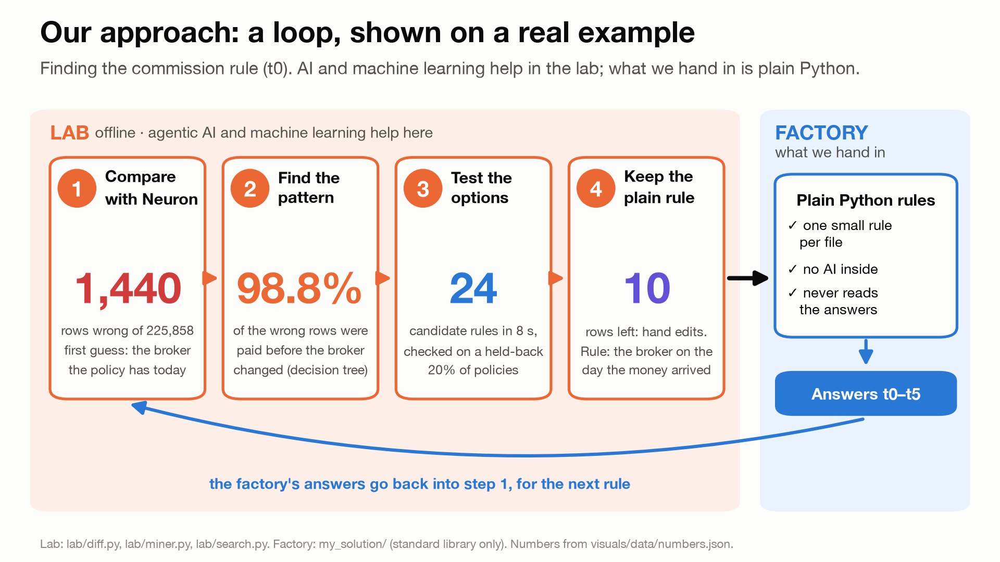
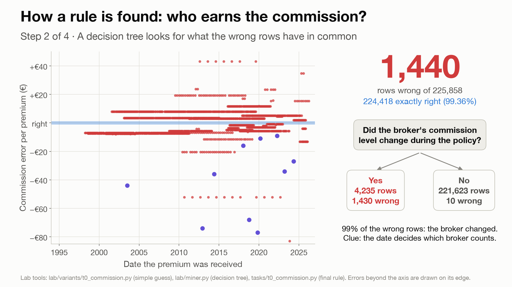
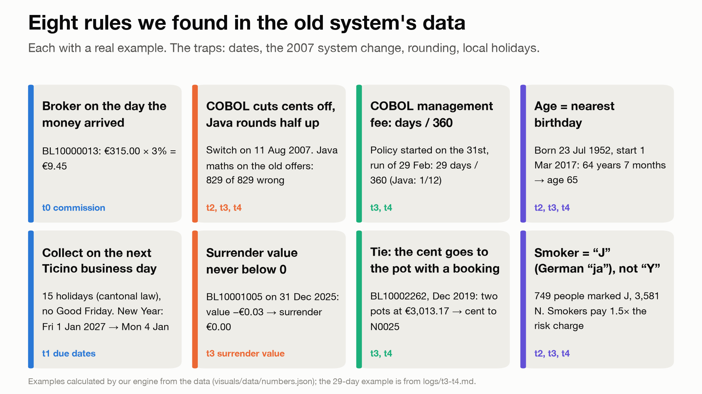
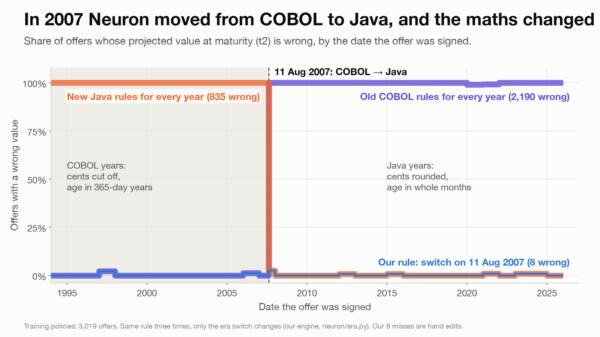
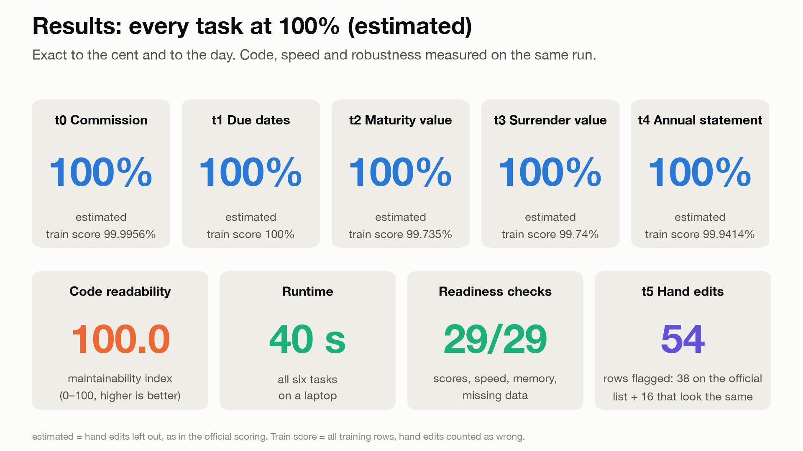
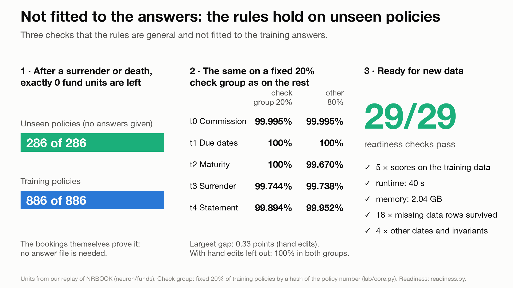

# Rebuilding Neuron: 30 years of insurance rules, exact to the cent

*Lifeware challenge, Neural Wave Hackathon 2026 · Amar Omerovic, Uzair Naeem, Aanchal Aanchal, Davide Frosi, Fatih Tkin*

## The problem

Since 1994 a life insurer in Ticino has run its policies on Neuron, a system written in COBOL and later partly in Java.
Neuron is being switched off, and nobody knows its formulas any more. From its data and its answers for 60% of the
policies, we had to rebuild every rule in Python, exact to the cent and to the day.

## Our approach

We split the work into a lab and a factory. The lab finds the rules. It lists the rows we get wrong, looks for what
they have in common, and tests every choice of date and rounding on 80% of the policies before it checks the winner on
the other 20%. The factory is the code we hand in. It is plain Python with no AI inside, and it reads every rate from
Neuron's own tables.

<!-- page -->

## How we find a rule

Our first commission rule used each policy's current broker and got 1,440 of 225,858 rows wrong. A decision tree
showed that 1,430 of them were on policies whose broker had changed tier. A search over 24 versions then picked the
broker on the day the money arrived, and only 10 rows were left.

## Rules we found

These eight rules were the hardest to find. Most of them are old habits of the system that nobody wrote down, like
the holidays of canton Ticino or a smoker flag in German.

## Hidden rules have dates

On 11 August 2007 Neuron moved from COBOL to Java, and the maths changed. COBOL cut off extra cents and counted ages
in 365-day years. Java rounds half up and counts ages in whole months.

<!-- page -->

## Results

We miss 54 training rows, exactly the 54 that t5 flags as hand edits. 38 of them are on Neuron's own correction list,
and the other 16 also move by whole euros, so we believe they are unlisted edits. Without hand edits we estimate 100%
on every task.

## It works on data it has never seen

286 public policies, which come without answers, ended by surrender or death. One wrong charge anywhere would leave
fund units over or short, and our replay ends all 286 at exactly zero. The code has no fitted numbers, and it passes
29 of 29 readiness checks.

## What didn't work

| Idea | What happened |
|---|---|
| Smoker flag `Y` | The data uses `J`, for the German "Ja". Our risk charges for smokers were exactly 1.5 times too low. |
| One due-date rule for everyone | 27 or 115 policies wrong. COBOL and Java each had their own rule. |
| A "fair" split of fees between pots | Fully exact policies fell from 99.87% to 20.7%. The real cause was a €1.88 pot with no booking row. |
| Other day counts (30/360, Act/365) | 1,514 surrender values wrong with each. COBOL used days ÷ 360. |
| Floats in early tests | One-cent drifts. We use `Decimal` everywhere now. |

## How we used AI

We built this utilizing agentic AI. Several AI agents worked in parallel on separate tasks, and one coordinating agent
re-ran every score itself before it accepted a result. We set the rules, chose the priorities and reviewed every
change, and no AI runs inside the submission.

Interactive charts: [report/interactive.html](interactive.html) (open it in a browser). Code:
`LifewareChallenge/participants/starter_kit/my_solution/` (rules in its README), lab tools in `lab/`, every attempt
and failure in `logs/`.
